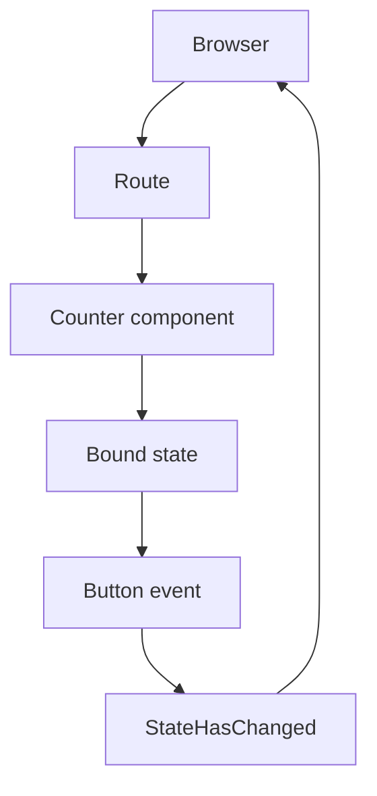

# Counter Application

## Purpose

- Beginner project for components and events.
- Demonstrates binding, state, and timers.
- Uses responsive Bootstrap controls.

## Features

- Increment and decrement values.
- Configure the increment step.
- Reset the counter.
- Display the current system time.
- Block invalid step values.

## Run

```powershell
dotnet run --project CounterApp
```

Open the URL shown in the terminal.

## Flow



## Structure

- `Components/Pages/Counter.razor`: UI and component state.
- `Components/Layout/`: Application layout.
- `wwwroot/app.css`: Shared static styling.

## Issues And Enhancements

| Priority | Area        | Status   | Requirement                     |
| -------- | ----------- | -------- | ------------------------------- |
| Medium   | Overflow    | Open     | Handle extreme numeric input    |
| Medium   | Calculator  | Open     | Add arithmetic operations       |
| Low      | Persistence | Deferred | Preserve value across refreshes |

## Interview Concepts

- Server components hold state in circuit memory.
- `@onclick` invokes a component event handler.
- `@bind` creates a UI-to-state update pair.
- `StateHasChanged` renders the updated component.
