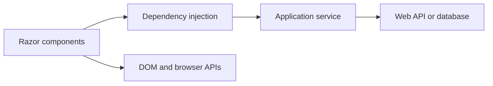
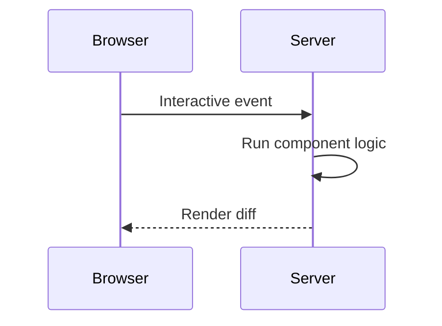

# Blazor Fundamentals

## 1. Introduction to Blazor

- Blazor is a .NET framework for building interactive web user interfaces with C# and Razor.
- Razor combines HTML markup and C# expressions in `.razor` files.
- It can reduce JavaScript-only duplication because reusable UI and business logic can use C#.
- A Blazor app can be interactive on the server, in WebAssembly, or hybrid according to the application model.

```razor
@page "/welcome"
<h1>Hello, @name</h1>
@code {
    private string name = "Blazor";
}
```

## 2. Blazor Architecture



- Components produce render trees, events update component state, and Blazor updates the browser UI.
- For Interactive Server, the .NET component runs server-side in a SignalR circuit.
- For WebAssembly, component assemblies execute in the browser.
- The ASP.NET Core host supplies routing, middleware, security, static assets, and APIs.

## 3. Blazor Server vs WebAssembly

| Area        | Server                              | WebAssembly                                 |
| ----------- | ----------------------------------- | ------------------------------------------- |
| Execution   | On the server                       | In the browser                              |
| Download    | Small app payload                   | .NET runtime and assemblies                 |
| Startup     | Usually faster                      | Runtime download required                   |
| Latency     | Network round trip for interactions | Local processing after download             |
| State       | Server circuit memory               | Browser memory                              |
| Scalability | Circuit and connection resources    | More client-side resources                  |
| Offline     | Not generally self-contained        | Possible, but requires a PWA/offline design |
| Secrets     | Safer on server                     | Never store secrets in browser code         |



## Repository Example

- [Counter.razor](../CounterApp/Components/Pages/Counter.razor) uses `@rendermode InteractiveServer`.
- The counter component demonstrates component state and server-side event handling.

## Interview Questions

- What is a render? It is the process of producing the component's current UI representation.
- Is Blazor a replacement for JavaScript? No. JavaScript remains useful and is available through JS interop.
- What is a SignalR circuit? The logical server-side connection and state associated with an interactive server session.
