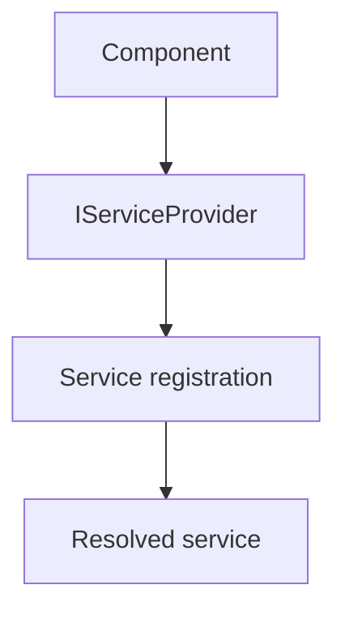

# Dependency Injection

- DI provides dependencies through an `IServiceProvider`.
- Constructor and `@inject` are common consumption patterns.
- Register services in `Program.cs`.
- Lifetimes control how long a service instance is reused.

```csharp
builder.Services.AddTransient<IIdService, IdService>();
builder.Services.AddScoped<IStudentService, StudentService>();
builder.Services.AddSingleton<ICacheService, MemoryCacheService>();
```

```razor
@inject IStudentService StudentService
```

| Lifetime  | Behavior                                      |
| --------- | --------------------------------------------- |
| Transient | One new instance for each resolution          |
| Scoped    | One instance per server circuit/request scope |
| Singleton | One instance for the application lifetime     |



Avoid singleton services that depend on scoped database or user state. Do not store per-user data in singleton services.
