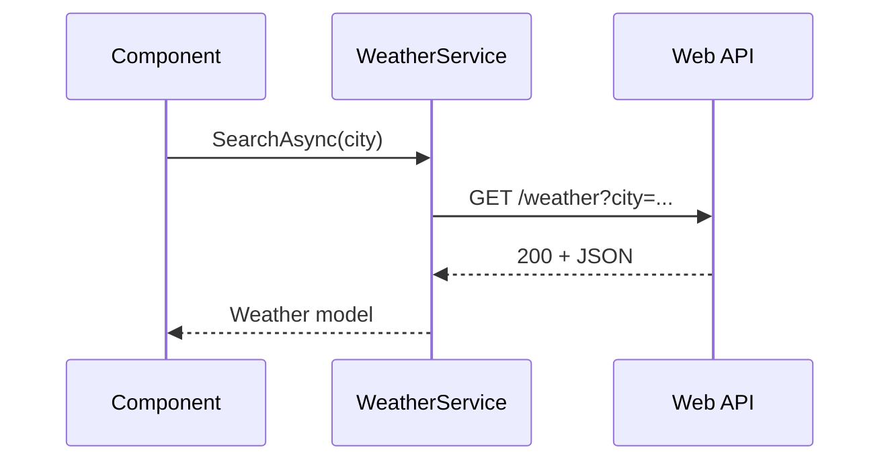

# HTTP And APIs

## HttpClient

- Use `HttpClient` through typed or named clients instead of creating clients per request.
- Use `GetFromJsonAsync`, `PostAsJsonAsync`, `PutAsJsonAsync`, and `DeleteAsync`.
- Read status codes and exception types to return useful UI feedback.
- Use cancellation for searches and navigation.

```csharp
builder.Services.AddHttpClient<IWeatherService, WeatherService>(client =>
{
    client.BaseAddress = new Uri("https://api.example.com/");
    client.Timeout = TimeSpan.FromSeconds(15);
});
```

```csharp
public async Task<Weather?> GetAsync(string city, CancellationToken cancellationToken)
{
    using var response = await httpClient.GetAsync(
        $"weather?city={Uri.EscapeDataString(city)}",
        cancellationToken);
    response.EnsureSuccessStatusCode();
    return await response.Content.ReadFromJsonAsync<Weather>(cancellationToken);
}
```

## Web API Integration

- APIs expose resources using routes and HTTP verbs.
- Use DTOs for public API contracts.
- Configure JSON options and CORS carefully.
- Secure APIs with authorization middleware and data-level ownership checks.
- Use `ProblemDetails` for consistent errors.



Store API keys in configuration or secrets, never in Razor or browser JavaScript.
