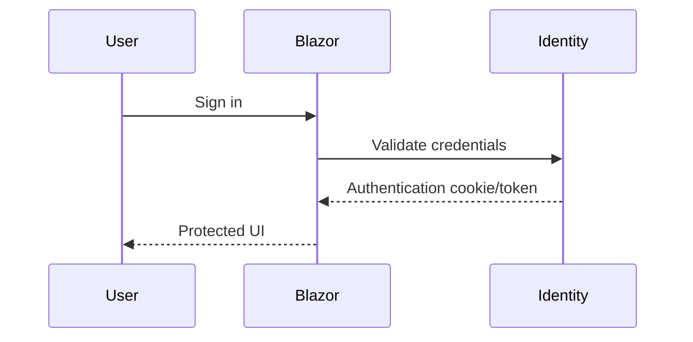

# Authentication And Security

- Authentication identifies who the user is.
- Authorization determines whether the user may perform an action.
- A claim describes a property or assertion about the identity.
- A role is a named claim used for role-based authorization.



## Blazor Features

- Use `CascadingAuthenticationState` in hosted applications.
- Use `AuthorizeView` for conditional UI.
- Use `[Authorize]` and `AuthorizeRouteView` for route protection.
- Use `[Authorize(Roles = "Admin")]` for role checks.

```razor
<AuthorizeView Roles="Admin">
    <Authorized>Admin tools</Authorized>
    <NotAuthorized>Not allowed</NotAuthorized>
</AuthorizeView>
```

Protected routes improve navigation, but the server API or repository must repeat authorization checks. A browser can bypass component-only restrictions.
