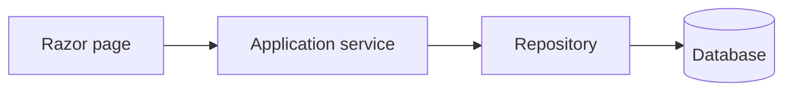

# CRUD Operations

CRUD means Create, Read, Update, and Delete.

| Operation | HTTP      | UI behavior                          |
| --------- | --------- | ------------------------------------ |
| Create    | POST      | Validate, save, refresh list         |
| Read      | GET       | Load, list, filter, paginate         |
| Update    | PUT/PATCH | Find entity, apply validated changes |
| Delete    | DELETE    | Confirm, delete, refresh state       |

## Implementation Rules

- Use one clear model for API transport or database persistence only where appropriate.
- Keep database change tracking out of Razor components.
- Add loading, empty, success, and failure states.
- Confirm destructive deletes.
- Requery or refresh after a create, update, or delete.
- Add pagination for large datasets.
- For server-backed CRUD, enforce ownership and authorization in the repository or API.
  Repository example:
- [Personal-Expense-Tracker](../Personal-Expense-Tracker) contains expense repositories and EF Core services.
