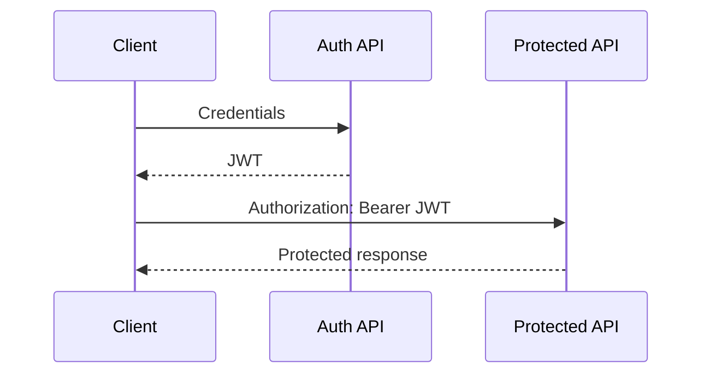

# JWT Authentication

A JSON Web Token carries signed claims used to authenticate API requests.



## Typical Setup

```csharp
builder.Services.AddAuthentication("Bearer")
    .AddJwtBearer(options =>
    {
        options.Authority = builder.Configuration["Jwt:Authority"];
        options.Audience = builder.Configuration["Jwt:Audience"];
    });
```

- Validate issuer, audience, lifetime, and signing key.
- Use HTTPS for token transport.
- Use short access-token lifetimes and a well-designed refresh strategy.
- Do not place secrets or sensitive private data in the payload.
- A JWT's signature protects integrity, but it does not automatically encrypt the payload.
- Store browser tokens according to the application threat model; HTTP-only secure cookies can be safer for browser sessions.
