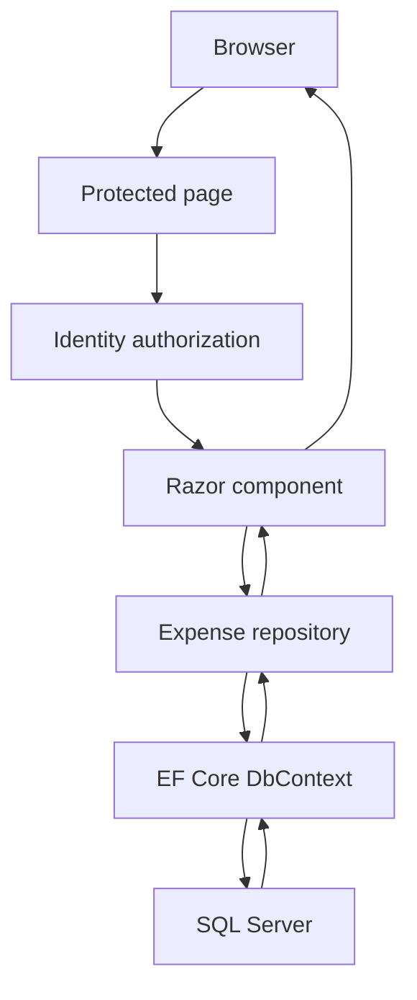

# Personal Expense Tracker

## Purpose

- Advanced full-stack Blazor project.
- Demonstrates Identity, EF Core, and repositories.
- Demonstrates role-based authorization.

## Features

- Register and sign in.
- Add, edit, and delete expenses.
- Filter by search, category, month, and year.
- Export filtered expenses as CSV.
- Review monthly totals and chart data.
- Manage categories with the Admin role.

## Prerequisites

- .NET 10 SDK.
- SQL Server or SQL Server Express.
- Access to the configured SQL instance.

## Configuration

- Set `ConnectionStrings:DefaultConnection` in environment variables or user secrets.
- Do not commit passwords or production connection strings.
- Default development accounts are seeded in `Program.cs`.

## Run

```powershell
dotnet run --project Personal-Expense-Tracker
```

The application migrates and seeds the database at startup.

## Flow



## Structure

- `Data/`: Identity and EF Core context.
- `Domain/`: Expense and category models.
- `Repositories/`: Data access implementations.
- `Services/`: Filter-state behavior.
- `Components/Pages/`: Login and application pages.

## Issues And Enhancements

| Priority | Area           | Status      | Requirement                               |
| -------- | -------------- | ----------- | ----------------------------------------- |
| High     | Database setup | Open        | Replace machine-specific connection setup |
| High     | Authorization  | Resolved    | Protect expense routes                    |
| Medium   | Validation     | Open        | Improve expense form validation           |
| Medium   | Secrets        | In Progress | Move credentials to user secrets          |
| Low      | Reporting      | Open        | Add annual summaries                      |

## Interview Concepts

- Identity provides authentication and role management.
- Repositories isolate EF Core queries.
- `DbContext` tracks entities and unit of work.
- Migrations version database schema.
