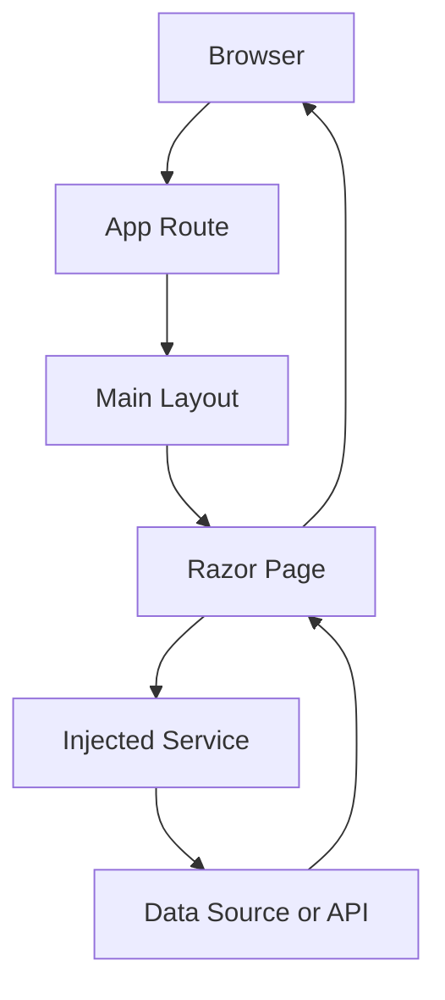

# Blazor Projects Cleanup and Learning Plan

## 1. Objective

Improve all five Blazor projects without changing their core purpose.

- Keep each project focused on its learning stage.
- Remove unnecessary and generated repository files.
- Replace custom CSS with Bootstrap utilities where practical.
- Document known issues and recommended enhancements.
- Explain every project with beginner-friendly Mermaid diagrams.
- Create concise interview notes for Blazor and ASP.NET Core concepts.

---

## 2. Repository Scope

| Project                  | Folder                       | Primary Learning Stage                |
| ------------------------ | ---------------------------- | ------------------------------------- |
| Counter and Calculator   | `CounterApp/`                | Components, events, binding           |
| Todo Application         | `ToDoApp/`                   | Models, lists, state, callbacks       |
| Student Management       | `Student-Management-System/` | Forms, validation, services           |
| Weather Dashboard        | `Weather-Dashboard/`         | HttpClient, async APIs, errors        |
| Personal Expense Tracker | `Personal-Expense-Tracker/`  | EF Core, repositories, authentication |

Run baseline builds before modifications:

```powershell
dotnet build Blazor-Projects.slnx
```

## Document build warnings and runtime defects before implementation.

## 3. Execution Order

```mermaid
flowchart LR
    A[Baseline and audit] --> B[Repository cleanup]
    B --> C[Fix CounterApp]
    C --> D[Fix ToDoApp]
    D --> E[Fix Student system]
    E --> F[Fix Weather dashboard]
    F --> G[Fix Expense tracker]
    G --> H[Project READMEs]
    H --> I[Learning notes]
    I --> J[Solution verification]
```



Complete one project at a time.

- Build the project before edits.
- Record issues in a project-specific table.
- Apply fixes in small, reviewable batches.
- Build and manually test after each batch.

---

## 4. Repository Cleanup

### Remove from source control

- `bin/` and `obj/` build outputs.
- IDE-specific `.vs/` and `.idea/` folders.
- Duplicate or unused CSS and JavaScript files.
- Trial, demo, or unrelated personal files.
- Generated test screenshots not used by documentation.

### Preserve in source control

- Project source files and Razor components.
- Project and solution files.
- Required Bootstrap distribution files.
- Migration source and model snapshot files.
- Application and development configuration templates.
- Project screenshots explicitly referenced by documentation.

### Review every project

- Add missing `.gitignore` entries.
- Remove stale package folders and temporary artifacts.
- Keep only required static assets.
- Ensure folder names and namespaces are consistent.
- Verify launch settings contain valid application URLs.

---

## 5. Bootstrap Standardization

Use Bootstrap classes for layout and common components.
| UI Need | Preferred Bootstrap Pattern |
|---|---|
| Page spacing | `container`, `py-*`, `mb-*`, `gap-*` |
| Grid layout | `row`, `col-*`, `col-sm-*`, `col-lg-*` |
| Buttons | `btn`, `btn-primary`, `btn-danger`, `btn-outline-*` |
| Forms | `form-control`, `form-label`, `form-select`, `invalid-feedback` |
| Tables | `table`, `table-striped`, `table-hover`, `table-responsive` |
| Feedback | `alert`, `spinner-border`, `badge`, `toast` |
| Navigation | `navbar`, `nav`, `nav-link`, `dropdown-*` |
Remove component CSS files only after verifying that no unique behavior remains.

- Replace fixed widths with responsive container classes.
- Replace custom spacing with Bootstrap spacing utilities.
- Replace custom flex rules with `d-flex`, `justify-*`, and `align-*`.
- Retain custom CSS only for meaningful brand elements or charts.

---

## 6. Project Audit Checklist

Create one issues and enhancements table per project.
| Priority | Area | Requirement |
|---|---|---|
| High | Build | Project compiles without errors |
| High | Runtime | Pages and routes load successfully |
| High | Forms | Invalid input is blocked clearly |
| High | Exceptions | API and database failures are handled |
| Medium | Accessibility | Labels, contrast, and keyboard use are valid |
| Medium | Responsive UI | Layout works on mobile and desktop |
| Medium | Code quality | Namespaces and folders remain consistent |
| Low | Documentation | Features and setup steps are explained |
Use these statuses:

- `Open`
- `In Progress`
- `Resolved`
- `Deferred`

---

## 7. Project Enhancement Plan

### 7.1 CounterApp

- Verify counter increment, decrement, and reset behavior.
- Add calculator operations and clear behavior.
- Use Bootstrap buttons and responsive cards.
- Centralize invalid or boundary states.
- Document component request and render flow.

### 7.2 ToDoApp

- Verify add, edit, complete, and delete actions.
- Add completion and search filters.
- Replace duplicate task models with one clear model.
- Use stable keys in list rendering.
- Add empty and no-result states.
- Document parent-child component communication.

### 7.3 Student Management System

- Verify add, edit, delete, search, and sort flows.
- Improve `EditForm` and validation messages.
- Prevent duplicate student identifiers if applicable.
- Separate UI data from domain models.
- Add empty, loading, and save-feedback states.
- Document form submission and validation flow.

### 7.4 Weather Dashboard

- Verify city search and API configuration.
- Move secrets and API keys into configuration.
- Configure `HttpClient` through dependency injection.
- Add loading and retry feedback.
- Handle network, timeout, and invalid-city failures.
- Document HTTP request and response flow.

### 7.5 Personal Expense Tracker

- Verify authentication, authorization, and navigation.
- Verify EF Core migrations and database initialization.
- Review repository interfaces and implementations.
- Complete category and expense CRUD behavior.
- Ensure filter state is independent and predictable.
- Add monthly summaries and useful empty states.
- Do not expose secrets or account data in configuration.
- Document database, repository, service, and component flow.

---

## 8. README Requirements

Create or update `README.md` inside each project.
Each README must contain:

1. Project purpose and learning level.
2. Implemented features and supported operations.
3. Technology and package overview.
4. Prerequisites and configuration steps.
5. How to run the project locally.
6. Folder structure and responsibility summary.
7. Mermaid runtime-flow chart.
8. Mermaid component or architecture diagram.
9. Issues and enhancements table.
10. Interview concepts and common follow-up questions.
    Keep README text brief and practical.

- Use bullet points of roughly five to eight words.
- Use headings to improve scanning.
- Use Mermaid for every important request flow.
- Link configuration steps to the actual files.

---

## 9. Mermaid Documentation Standard

Use simple Mermaid diagrams for consistent documentation.



Document these flows where relevant:

- Component initialization and event handling.
- Form submission and validation.
- Dependency injection service resolution.
- HTTP request and JSON processing.
- Repository to database operations.
- Authentication and authorization redirects.

---

## 10. Learning Folder

Create `Learning/` at the repository root.
Recommended structure:

```text
Learning/
├── 01-Blazor-Fundamentals.md
├── 02-Razor-Components.md
├── 03-Data-Binding-and-Events.md
├── 04-Routing-and-Navigation.md
├── 05-Forms-and-Validation.md
├── 06-Dependency-Injection.md
├── 07-HTTP-and-APIs.md
├── 08-EF-Core-and-Data.md
├── 09-Authentication-and-Security.md
├── 10-State-Management.md
├── 11-Bootstrap-and-Responsive-UI.md
└── 12-Interview-Revision.md
```

Each note must be interview ready.

- Use short headings and bullet points.
- Explain the concept in simple terms.
- Include syntax only for essential examples.
- Add project usage and interview follow-ups.
- Avoid large paragraphs and copied documentation.

---

## 11. Interview Notes Format

Use a consistent format for every topic.

```markdown
## Concept Name

- Meaning: Explain in one sentence.
- Blazor flow: Describe component rendering.
- Example: Reference a project file.
- Interview answer: Give a concise explanation.
- Follow-up: Explain one deeper question.
```

Example topics:

- Server-side versus WebAssembly rendering.
- Component lifecycle and `OnInitializedAsync`.
- Render modes and interactive components.
- Data binding and event callbacks.
- Scoped, singleton, and transient services.
- `EditForm`, validators, and `DataAnnotationsValidator`.
- Repository pattern and service separation.
- EF Core migrations and `DbContext`.
- Cancellation and async exception handling.
- Authentication and authorization in Blazor.

---

## 12. Validation Plan

Run for the complete solution:

```powershell
dotnet build Blazor-Projects.slnx
```

Also validate each project individually:

```powershell
dotnet build CounterApp/CounterApp.csproj
dotnet build ToDoApp/ToDoApp.csproj
dotnet build Student-Management-System/Student-Management-System.csproj
dotnet build Weather-Dashboard/Weather-Dashboard.csproj
dotnet build Personal-Expense-Tracker/Personal-Expense-Tracker.csproj
```

Manual test matrix:
| Check | Expected Result |
|---|---|
| Application starts | Home page and navigation load |
| Valid user action | Data changes and UI updates |
| Invalid form action | Clear validation message appears |
| Missing API data | Loading or error state appears |
| Database unavailable | Application fails safely |
| Mobile viewport | Controls remain usable |
| Desktop viewport | Layout uses available space |
| Navigation | Browser back and route links work |

---

## 13. Definition of Done

- Repository build succeeds for every project.
- No build output or IDE folders are committed.
- Custom CSS is removed or justified.
- Bootstrap provides the common UI layout.
- Each project has a complete README.
- Each project includes issues and enhancements.
- Each README includes clear Mermaid flows.
- Learning notes cover fundamental and interview topics.
- No secrets or production credentials exist in source.
- All changed behavior is manually verified.
