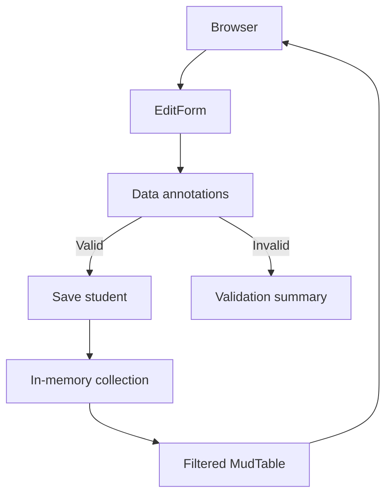

# Student Management System

## Purpose

- Intermediate form and validation project.
- Demonstrates MudBlazor controls.
- Demonstrates local CRUD state.

## Features

- Add, edit, and delete students.
- Search and filter records.
- Validate names, ages, emails, and departments.
- Prevent duplicate email addresses.
- Export filtered records as CSV.

## Prerequisites

- .NET 10 SDK.
- A supported browser.

## Run

```powershell
dotnet run --project Student-Management-System
```

## Flow



## Issues And Enhancements

| Priority | Area              | Status   | Requirement                     |
| -------- | ----------------- | -------- | ------------------------------- |
| High     | Duplicate records | Resolved | Block duplicate email addresses |
| Medium   | Persistence       | Open     | Add database storage            |
| Medium   | Confirmation      | Open     | Confirm destructive deletes     |
| Low      | Sorting           | Open     | Add sortable table headers      |

## Interview Concepts

- `EditForm` coordinates model validation.
- `DataAnnotationsValidator` reads validation attributes.
- MudBlazor components wrap Bootstrap-compatible UI.
- In-memory data is lost when the app restarts.
