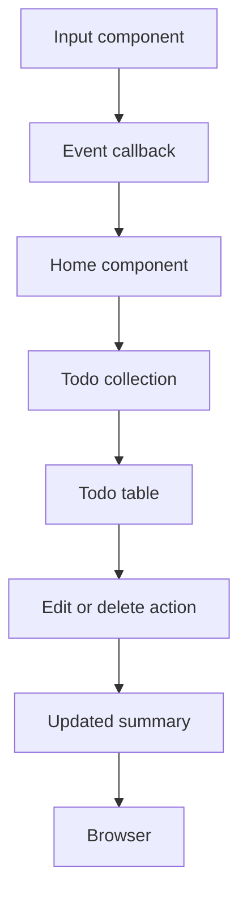

# Todo Application

## Purpose

- Beginner project for lists and component state.
- Demonstrates parent-child parameters.
- Uses Bootstrap responsive patterns.

## Features

- Add and clear tasks.
- Edit task text.
- Mark tasks complete.
- Delete tasks.
- Search and filter tasks.
- Review total, pending, and completed counts.

## Run

```powershell
dotnet run --project ToDoApp
```

## Flow



## Structure

- `Models/TodoTask.cs`: Single task model.
- `Components/Pages/Home.razor`: State and summary.
- `Components/Pages/InputToDo.razor`: Task entry.
- `Components/Pages/ToDoTable.razor`: Task operations.

## Issues And Enhancements

| Priority | Area        | Status   | Requirement                |
| -------- | ----------- | -------- | -------------------------- |
| Medium   | Persistence | Open     | Save tasks after refresh   |
| Medium   | Editing     | Resolved | Validate empty edited text |
| Low      | Sorting     | Open     | Add sort controls          |

## Interview Concepts

- Components communicate through parameters.
- Event callbacks notify parent components.
- `@key` improves stable list rendering.
- Collection changes trigger a render.
