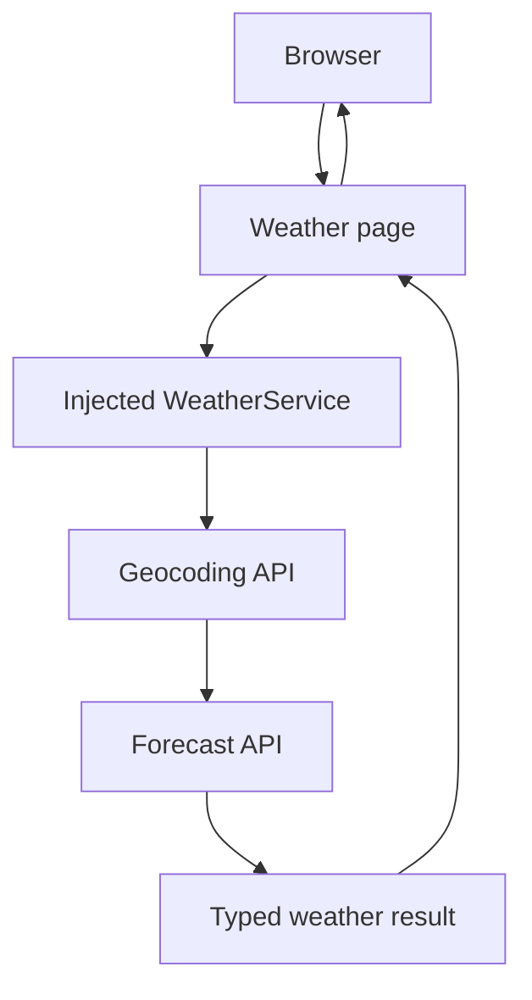

# Weather Dashboard

## Purpose

- Intermediate API integration project.
- Demonstrates HttpClient and async errors.
- Uses Open-Meteo geocoding and weather APIs.

## Features

- Search weather by city.
- Show temperature, wind, humidity, and icon.
- Display loading feedback.
- Handle missing cities and network failures.

## Run

```powershell
dotnet run --project Weather-Dashboard
```

No API key is required.

## Flow



## Structure

- `Program.cs`: HttpClient registration.
- `Services/WeatherService.cs`: API requests and failures.
- `Components/Pages/Home.razor`: Loading and result UI.

## Issues And Enhancements

| Priority | Area       | Status   | Requirement                      |
| -------- | ---------- | -------- | -------------------------------- |
| High     | Timeout    | Resolved | Configure HttpClient timeout     |
| High     | Exceptions | Resolved | Map request failures to messages |
| Medium   | Retry      | Open     | Add one manual retry action      |
| Low      | Cache      | Open     | Cache recent city results        |

## Interview Concepts

- Inject HttpClient through dependency injection.
- `async` avoids blocking the request thread.
- Cancellation separates timeout and user cancellation.
- Typed JSON models protect UI code.
